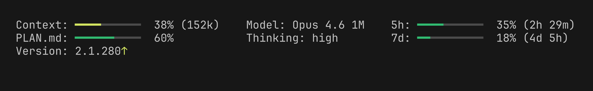

# claude-statusline

A terminal status line for Claude Code sessions.



## Install

```bash
cargo install --path .
```

## Configuration

Add to `~/.claude/settings.json`:

```json
{
  "statusLine": {
    "type": "command",
    "command": "~/.cargo/bin/claude-statusline"
  }
}
```

## Components

- **Context**: Current context window usage percentage
- **Model**: Active Claude model name
- **PLAN.md**: Progress on tasks in PLAN.md
- **5h/7d**: API rate limit usage with time until reset

## How It Works

### Data Sources

| Component | Source |
|-----------|--------|
| Context | `context_window.used_percentage` from stdin JSON |
| Model | `model.display_name` from stdin JSON |
| PLAN.md | Counts `- [x]` and `- [ ]` checkboxes in `./PLAN.md` |
| 5h/7d | Anthropic API (`/api/oauth/usage`) via background fetch |

Claude Code pipes session JSON to stdin when invoking the statusline command.

### Credentials

OAuth token is read from macOS Keychain using the `security` command:

```bash
security find-generic-password -s "Claude Code-credentials" -w
```

### Cache

Usage data is fetched in the background and cached at:

```
~/.cache/claude-statusline/usage.json
```

Cache refreshes every 60 seconds. A lock file prevents concurrent fetches:

```
~/.cache/claude-statusline/usage.lock
```

### Logs

Errors are appended to:

```
~/.cache/claude-statusline/error.log
```

## License

[0BSD](LICENSE)
